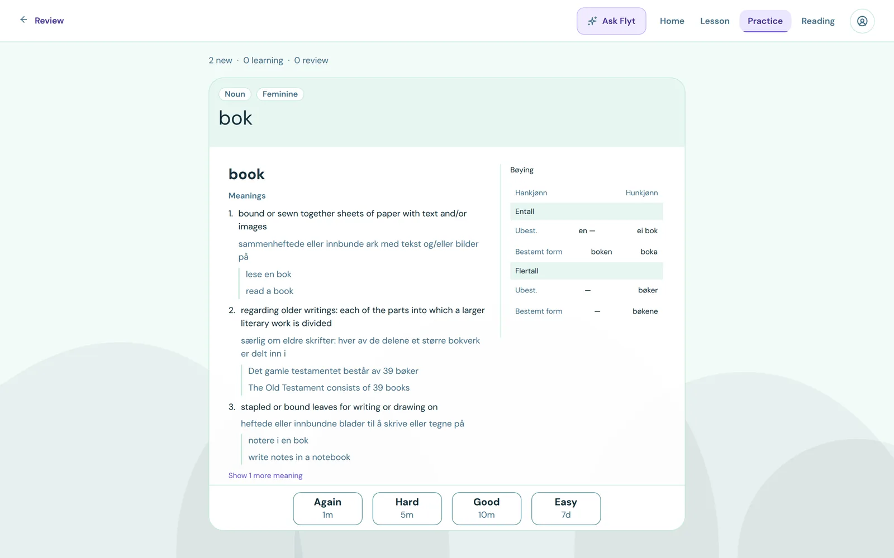
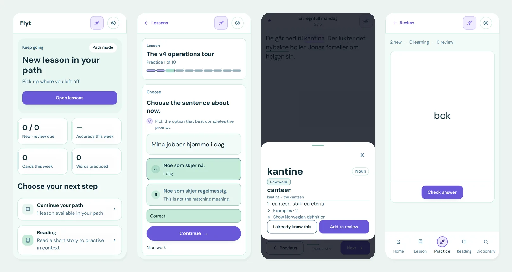
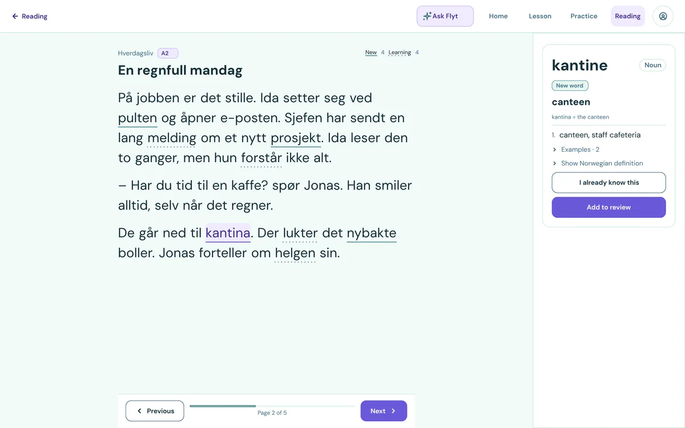
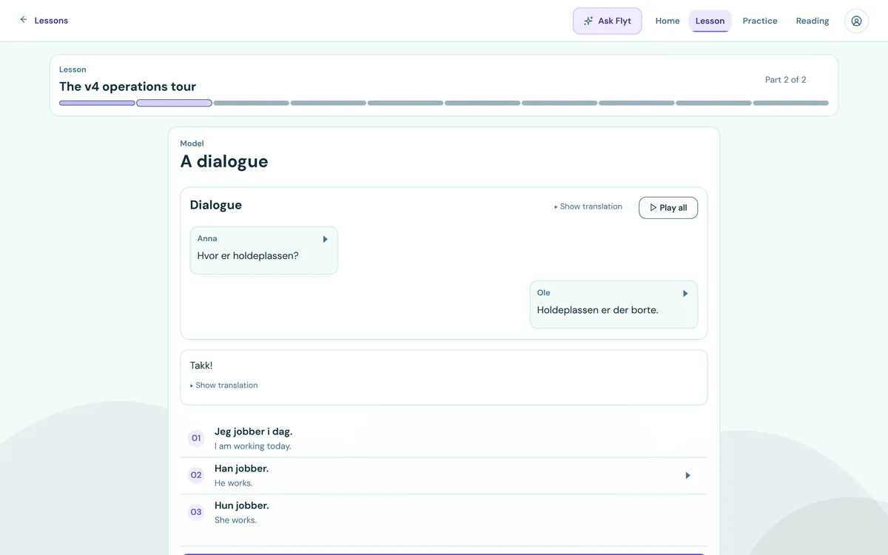
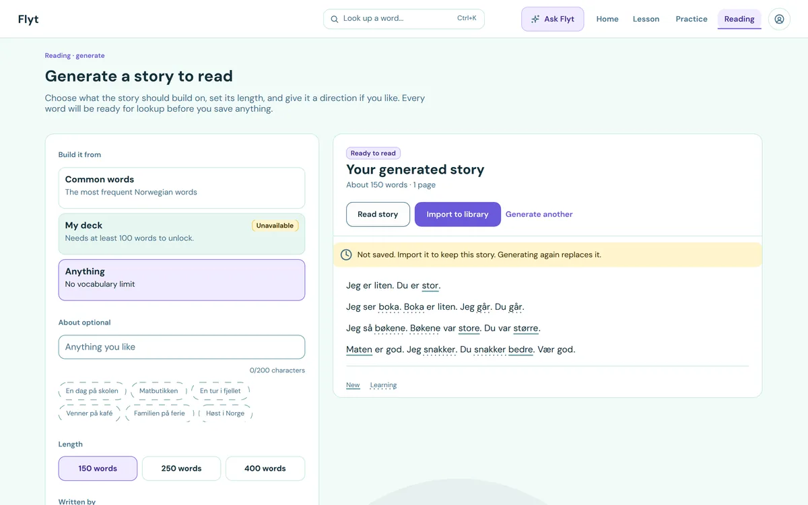
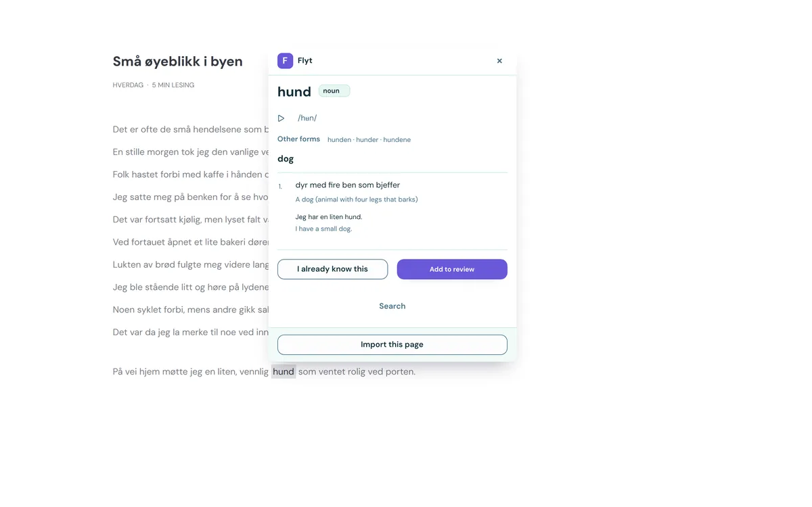

# Flyt

**Learn Norwegian Bokmål through lessons, reading, and spaced repetition.**

[](https://github.com/Chalvin96/flyt/actions/workflows/master.yml)
[](LICENSE)

Flyt brings learning and practice into one place. Work through a lesson, read
Norwegian with a dictionary at hand, and review the concepts and words you save.

**[Open Flyt](https://flyt.umebocchi.my.id)** ·
[Run locally](knowledge/operations/runtime.md#running-the-stack) ·
[Runtime guide](knowledge/operations/runtime.md) ·
[Privacy](https://flyt.umebocchi.my.id/about#privacy)

The hosted app is free and uses Google Sign-In. There is no paid tier or
expiring trial.





## How learning works

1. **Learn a concept.** Follow a CEFR-organised curriculum with explanations,
   examples, audio, and interactive exercises. Completing a lesson adds its
   concepts to your review schedule.
2. **Meet it in context.** Read curated stories, import articles, or generate
   stories around vocabulary from your learning activity. Look up unfamiliar
   words as you read and save them for practice.
3. **Review over time.** FSRS spaced repetition schedules your next reviews.
   Cards rotate through variants of a concept, and your review history informs
   your progress.

You can also:

- **Explore the dictionary:** look up definitions, inflections, and
  pronunciation from Ordbokene data, with English glosses supplied by the
  companion [norsk-lemma](https://github.com/Chalvin96/norsk-lemma) project.
- **Read across the web with FlytLese:** the Chrome and Firefox extension offers word
  lookup, text translation, vocabulary saving, and article import. Chrome and
  Firefox store listings are not published yet. Safari is not supported.
- **Ask for help:** the chatbot can use your message and current page context.
  AI generation and chat depend on the deployment's provider configuration.

## A closer look

| Read with a dictionary at hand                                                                                                 | Learn through structured lessons                                                                                         |
| ------------------------------------------------------------------------------------------------------------------------------ | ------------------------------------------------------------------------------------------------------------------------ |
|            |  |
| **Generate a story from your own words**                                                                                       | **Look words up anywhere with FlytLese**                                                                                 |
|  |     |

## Engineering highlights

- **Typed end to end.** The FastAPI schema generates
  [`api.generated.ts`](frontend/src/types/api.generated.ts), and CI fails when
  the committed types drift from the API.
- **Spaced repetition you can trust.** Review scheduling uses
  [FSRS](https://github.com/open-spaced-repetition/py-fsrs). Each card rotates
  through exercise variants of one concept, and adding a word you already
  study never resets its schedule.
- **One design system for app and extension.** `@flyt/ui` and `@flyt/lexicon`
  are shared by the web app and the Manifest V3 extension. Storybook
  interaction tests cover the components.
- **Tested at every layer.** The backend suite runs against a real PostgreSQL
  and Redis. Vitest and Storybook cover the frontend, and Playwright runs the
  web app and the extension against a seeded Compose stack.
- **Ratchets, not wishes.** CI fails on migration drift. New test names,
  React Doctor findings, and design-system escape hatches are checked against
  committed limits, so none of them can grow past what the repository allows.
- **Documented decisions.** [`knowledge/`](knowledge/) records the current
  architecture and domain rules.

## Run locally

The development stack needs Python **3.12+**, [uv](https://docs.astral.sh/uv/),
Node **24+**, **pnpm 12**, PostgreSQL **16**, and Redis. The exact pnpm version is
pinned in [`package.json`](package.json); CI and the backend container use Python
3.14. Docker is also required for the isolated end-to-end test runners.

From a checkout of this repository, install the workspace dependencies and copy
the environment templates:

```bash
pnpm install --frozen-lockfile
cp backend/.env.example backend/.env
cp frontend/.env.example frontend/.env.local
```

Then follow the **[local setup guide](knowledge/operations/runtime.md#running-the-stack)** to
configure PostgreSQL and Redis, set real signing and provider-encryption keys,
install the locked Python dependencies, and apply migrations. The environment
templates need configuration before the API can start. The guide includes a
local login without Google OAuth and options for development without an AI
provider key.

Once configured, start each process in a separate terminal:

```bash
# API
uv run --directory backend uvicorn flyt.main:app --reload

# Background worker for reading imports and generation
uv run --directory backend arq flyt.worker.WorkerSettings

# Web app
pnpm --filter frontend dev
```

Open **http://localhost:5173**.

### Load learning content

Migrations create the database schema; lesson and dictionary content are
imported separately from public releases:

| Content                                                   | Producer                                                                  |
| --------------------------------------------------------- | ------------------------------------------------------------------------- |
| Lessons and their audio references                        | [norsk-lesson-factory](https://github.com/Chalvin96/norsk-lesson-factory) |
| Dictionary, pronunciation, and vocabulary frequency ranks | [norsk-lemma](https://github.com/Chalvin96/norsk-lemma)                   |

Use the [content import guide](knowledge/operations/runtime.md#loading-data-lessons-dictionary-reading-stories)
for download URLs, preview commands, and frequency-deck creation. Preview lesson
imports before applying them: a lesson release replaces the curriculum, removing
omitted lessons and their lesson-owned learner state. Lesson audio remains
hosted by the content producer.

## Develop

Read the [runtime guide](knowledge/operations/runtime.md) for setup, environment variables, tests,
and hooks. Backend tests require a disposable database; the
[testing guide](knowledge/operations/runtime.md#tests) provides an isolated setup. The browser and
extension end-to-end runners create and clean up their own Compose stacks.

Pull requests and `master` run the same [CI checks](.github/workflows/_ci.yml),
covering backend, frontend, extension, migrations, generated API types, and
security. Run the affected workspace checks before submitting a change.

### Repository layout

| Directory                                                                | Responsibility                                                                       |
| ------------------------------------------------------------------------ | ------------------------------------------------------------------------------------ |
| [`frontend/`](frontend/)                                                 | React, TypeScript, Vite, TanStack Router/Query, and Tailwind CSS web app             |
| [`backend/`](backend/)                                                   | FastAPI API, SQLAlchemy models, Alembic migrations, FSRS scheduling, and arq workers |
| [`extension/`](extension/)                                               | FlytLese Chrome and Firefox Manifest V3 extension                                    |
| [`packages/ui/`](packages/ui/), [`packages/lexicon/`](packages/lexicon/) | UI and dictionary components shared by the web app and extension                     |
| [`morph-svc/`](morph-svc/README.md)                                      | Optional morphology fallback service                                                 |
| [`knowledge/`](knowledge/)                                               | Durable product, domain, architecture, and design rationale                          |

PostgreSQL stores durable content and learner state; Redis supports transient
coordination and generation. The API and background worker run as separate
processes. Start with [system architecture](knowledge/architecture/system.md)
and [architecture decisions](knowledge/architecture/decisions.md) for the
engineering boundaries.

## Self-hosting and privacy

Backend and frontend container images publish to GHCR after CI passes on
`master`. Deployment is managed outside this repository. The
[operations guide](knowledge/operations/runtime.md#optional-services-and-operations) covers
migrations, workers, readiness checks, and recovery. The optional
[morphology](morph-svc/README.md) service has its own deployment guide.

The hosted app's [privacy policy](https://flyt.umebocchi.my.id/about#privacy)
explains account and learning data, external AI processing, error monitoring,
and data requests. Story generation can send selected vocabulary and story
instructions to a configured provider. Chat requests can send your message,
recent history, and page context to the selected provider. You can delete your
account in the app.

For deployment details, see [authentication and API boundaries](knowledge/architecture/auth-and-api.md)
and [provider credential rotation](knowledge/operations/runtime.md#provider-credential-rotation).

## Attribution and licenses

Flyt's application source code is licensed under the **[MIT License](LICENSE)**.
Imported dictionary and frequency data retain their own licenses and attribution
requirements.

### Dictionary data — CC BY 4.0

Dictionary data is derived from **Bokmålsordboka / Nynorskordboka**:

> Bokmålsordboka/Nynorskordboka, Universitetet i Bergen og Språkrådet, ordbøkene.no, CC BY 4.0.

[License](https://creativecommons.org/licenses/by/4.0/) ·
[Ordbøkene open data](https://ordbokene.no/nob/about/open-data) ·
[Citation guide](https://ordbokene.no/nob/help/cite)

The [norsk-lemma](https://github.com/Chalvin96/norsk-lemma) pipeline fetches,
enriches, and packages this data. English glosses are LLM-generated and may
contain errors; they are a learning aid, not an authoritative translation of
the source dictionaries.

### Vocabulary frequency data — CC BY-SA 4.0

Frequency ranking for the word-pack decks is derived from the **Norwegian Kelly
list**, used under [CC BY-SA 4.0](https://creativecommons.org/licenses/by-sa/4.0/):

> Norwegian Kelly list, UiO Text Laboratory (tekstlab.uio.no/kelly), CC BY-SA 4.0.
